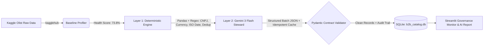

# B2B Smart Hybrid ETL & Data Quality Pipeline

A production-grade **Hybrid Data Engineering & AI Pipeline** designed to automate the sanitization, semantic enrichment, and governance of messy B2B marketplace partner onboarding data.

Built with a two-layer architecture, this pipeline offloads deterministic mathematical and structural fixes to **Pandas & Regex** (saving LLM latency and token costs) while leveraging **Gemini 3 Flash** with structured Pydantic contracts exclusively for complex semantic entity resolution and taxonomy mapping.

---

## Business Problem & Impact

Marketplace platforms (such as food delivery, fintech, and e-commerce ecosystems) ingest thousands of partner onboarding spreadsheets containing malformed tax IDs (CNPJs), unstructured currency strings (`"R$ 28.5 mil"`), heterogeneous dates, duplicate rows, and chaotic service descriptions.

- **Manual Bottleneck:** Data operations teams spend hours manually auditing spreadsheets before partners can go live.
- **Pipeline Solution:** Automates end-to-end ingestion, profiling, hybrid transformation, relational SQLite loading, and executive audit reporting in seconds.

### Key Results on Kaggle Olist Marketplace Sample
| Metric | Before ETL (Raw) | After Hybrid ETL | Impact / Delta |
| :--- | :---: | :---: | :--- |
| **Data Health Score** | `73.8%` | `95.6%` | **`+21.8%` Quality Lift** |
| **Deterministic Offload Rate** | — | `64.7%` | **22 fixes via Regex/Pandas (0 tokens)** |
| **Auto-Healing Rate** | — | `66.7%` | **Automatic recovery of defective rows** |
| **Sanitized Contract Volume** | Unstructured Strings | `R$ 852,757.10` | **100% Typed & Pydantic Validated** |

---

## System Architecture



### Engineering Highlights
1. **Automated Kaggle Ingestion (`src/etl/extractor.py`):** Pulls real Brazilian marketplace seller and category records from `olistbr/brazilian-ecommerce` via `kagglehub`, simulating realistic partner onboarding noise.
2. **Data Quality Profiler (`src/etl/profiler.py`):** Computes weighted **Data Health Scores (0–100%)** across Uniqueness (25%), Completeness (35%), and Format Validity (40%).
3. **Layer 1 — Deterministic Cleaning (`src/etl/deterministic.py`):** Resolves 64.7% of structural issues using zero-cost Regex/Pandas rules (CNPJ check-digit formatting, currency parsing, ISO date normalization, and exact deduplication).
4. **Layer 2 — Structured Batch AI Steward (`src/agents/cleaner_agent.py`):** Packages unresolved semantic fields into a single JSON batch request to `gemini-3-flash-preview` with exponential backoff (`tenacity`) and **idempotent local caching** (`ai_enrichment_cache.csv`).
5. **Relational Persistence & Auditability (`src/etl/loader.py`):** Enforces strict `CleanPartnerRecord` Pydantic schemas and loads both production tables (`b2b_partners`) and field-level before/after logs (`data_audit_trail`) into **SQLite**.

---

## Repository Structure

```text
b2b-smart-etl/
├── data/
│   ├── raw/                      # Raw Kaggle-derived B2B partner dataset
│   └── processed/                # Cleaned CSVs, AI cache, Audit Trail, and Executive Report
├── src/
│   ├── config.py                 # Centralized paths, credentials, and official B2B taxonomy
│   ├── etl/
│   │   ├── schemas.py            # Pydantic contracts (Raw, AIEnrichmentOutput, Clean)
│   │   ├── extractor.py          # Automated Kaggle dataset ingestion via kagglehub
│   │   ├── profiler.py           # Pre/Post ETL Data Health Score engine
│   │   ├── deterministic.py      # Layer 1 Pandas & Regex structural cleaning
│   │   └── loader.py             # Hybrid merger, Pydantic validator, and SQLite loader
│   ├── agents/
│   │   ├── prompts.py            # Dynamic Data Governance system instructions
│   │   └── cleaner_agent.py      # Layer 2 Gemini 3 Flash batch steward with idempotent cache
│   ├── analytics/
│   │   └── quality_report.py     # KPI calculator and AI Executive Data Quality Report generator
│   └── app.py                    # Interactive Streamlit Data Quality & Audit Dashboard
├── main.py                       # End-to-end CLI pipeline orchestrator
└── requirements.txt              # Locked project dependencies
```

---

## How to Run Locally

### 1. Clone & Set Up Environment
```bash
git clone [https://github.com/YOUR_USERNAME/b2b-smart-etl.git](https://github.com/YOUR_USERNAME/b2b-smart-etl.git)
cd b2b-smart-etl
python3 -m venv .venv
source .venv/bin/activate
pip install -r requirements.txt
```

### 2. Configure API Key
Copy `.env.example` to `.env` and add your Google Gemini API key:
```bash
cp .env.example .env
```

### 3. Execute the End-to-End ETL Pipeline
```bash
python3 main.py
```

### 4. Launch the Interactive Governance Dashboard
```bash
streamlit run src/app.py
```